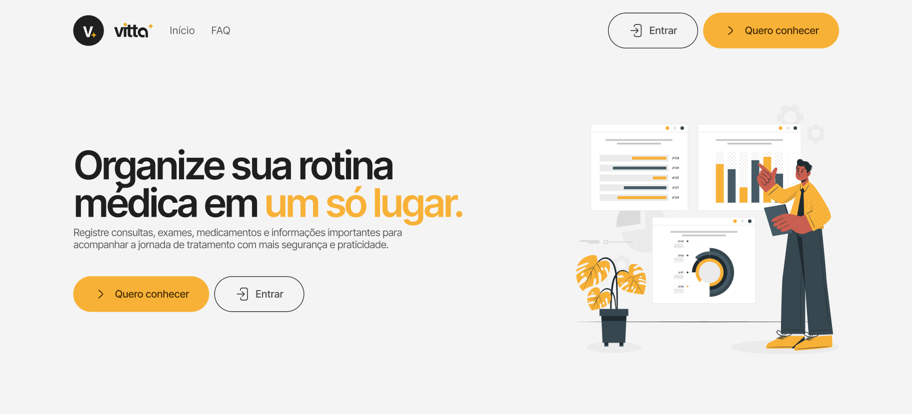
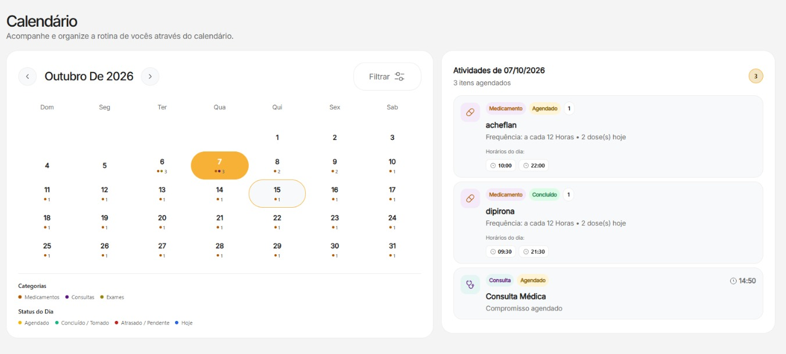

# DESENVOLVIMENTO DE UM SISTEMA WEB PARA ORGANIZAÇÃO DE PROCEDIMENTOS MÉDICOS POR PAIS E RESPONSÁVEIS DE CRIANÇAS E ADOLESCENTES EM TRATAMENTO ONCOLÓGICO


[**Acessar o Vitta**](https://vittav5-frontend.vercel.app/)

## Descrição

O Vitta é um sistema web desenvolvido pelo Grupo 09 do curso Técnico em Informática para Internet integrado ao Ensino Médio da ETEC de Campo Limpo Paulista. O projeto auxilia pais e responsáveis a organizar a rotina de crianças e adolescentes em tratamento oncológico.

Acompanhar consultas, exames, horários de medicamentos e documentos pode ser difícil quando essas informações ficam espalhadas. O Vitta reúne os registros em um painel por criança ou adolescente e apresenta os compromissos em um calendário.

## Equipe

| Integrante | Função no TCC |
| --- | --- |
| Daniel Barros de Oliveira | Coautor do projeto |
| Jerry Leonardo Alves Das Flores | Coautor do projeto |
| Matheus dos Santos Galvão Dias | Coautor do projeto |

**Orientação** — Barbara Kathellen Andrade Porfirio e Thaynara Cristina Maia dos Santos.

## Funcionalidades

- **Visão Geral** — indicadores de acompanhamento, filtros por período e próximos compromissos.
- **Medicamentos** — registro e acompanhamento de horários, doses e situação dos itens cadastrados.
- **Consultas e exames** — organização dos compromissos com data, horário, local e profissional.
- **Calendário** — agenda que reúne medicamentos, consultas e exames por dia.
- **Documentos** — organização de arquivos em pastas e busca de registros.
- **Mapa de Saúde** — busca de hospitais, clínicas, UBS e farmácias.
- **Perfis de crianças e adolescentes** — seleção do perfil associado aos registros da rotina.
- **Vitta IA** — chat com os modos Assistente e Suporte. O fluxo de cadastro de exames por conversa está em validação na versão web.

## Tecnologias utilizadas

| Tecnologia | Versão | Uso |
| --- | --- | --- |
| TypeScript | 6.0.3 | Linguagem da aplicação |
| React e React DOM | 19.2.3 | Interface e renderização web |
| React Native | 0.85.3 | Componentes multiplataforma |
| React Native Web | 0.21.2 | Adaptação da interface para o navegador |
| Expo | SDK 56 (56.0.23) | Desenvolvimento e exportação |
| Expo Router | 56.2.21 | Navegação |
| Firebase JS SDK | 12.15.0 | Acesso ao Firebase, incluindo Authentication e Cloud Firestore |
| Node.js | 24.3.0 ou superior na linha 24.x | Ambiente local de desenvolvimento |
| Vercel | Serviço hospedado | Publicação da versão web |

As versões das dependências seguem o `frontend/package-lock.json`. O requisito de Node.js segue a faixa 24.x aceita pelo React Native do projeto.

## Imagens do sistema

### Página inicial



### Calendário



## Estrutura do repositório

| Caminho | Conteúdo |
| --- | --- |
| [`docs/`](docs/) | Trabalho escrito do Grupo 09 |
| [`frontend/src/`](frontend/src/) | Código-fonte da aplicação Expo |
| [`design/`](design/) | Logo, protótipos, diagramas e imagens das telas |
| [`database/`](database/) | Documentação da estrutura de dados no Firebase |

## Como executar o projeto

1. Instale o Git e uma versão do Node.js compatível com a tabela acima.
2. Clone o repositório e entre na pasta do frontend.

   ```bash
   git clone https://github.com/jeh7sx/VittaV5.git
   cd VittaV5/frontend
   ```

3. Instale as dependências.

   ```bash
   npm ci
   ```

4. Inicie a versão web.

   ```bash
   npm run web
   ```

5. Abra o endereço mostrado no terminal. Para experimentar a versão publicada, acesse [Vitta online](https://vittav5-frontend.vercel.app/).

Para exportar a versão web, execute `npm run build` dentro de `frontend/`. A saída é gerada em `frontend/dist/`.

## Como citar o projeto

OLIVEIRA, Daniel Barros de; FLORES, Jerry Leonardo Alves Das; DIAS, Matheus dos Santos Galvão. **Desenvolvimento de um sistema web para organização de procedimentos médicos por pais e responsáveis de crianças e adolescentes em tratamento oncológico**. 2026. Trabalho de Conclusão de Curso (Técnico em Informática para Internet integrado ao Ensino Médio) — ETEC de Campo Limpo Paulista, Campo Limpo Paulista, 2026.

[Consultar o trabalho escrito](docs/grupo09_EntregaFinal.docx)

## Contato

[vittaetec@gmail.com](mailto:vittaetec@gmail.com)
